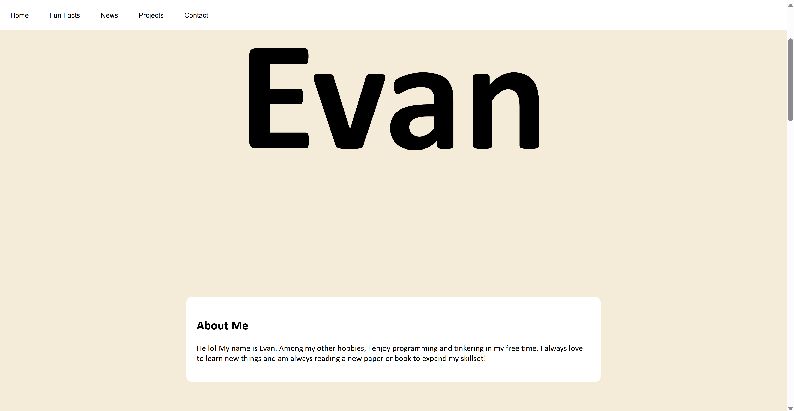
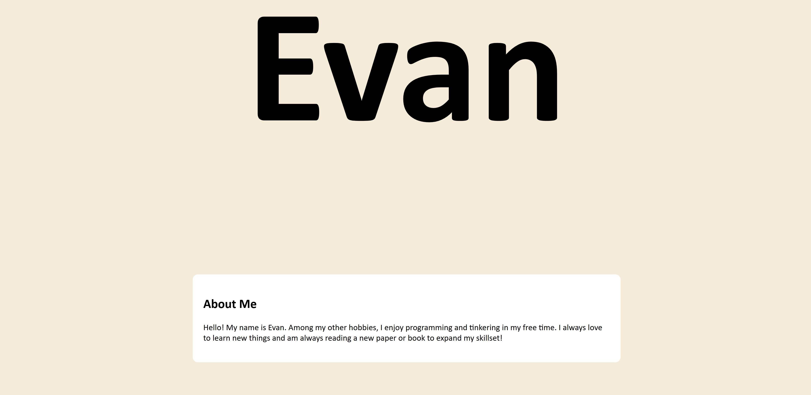
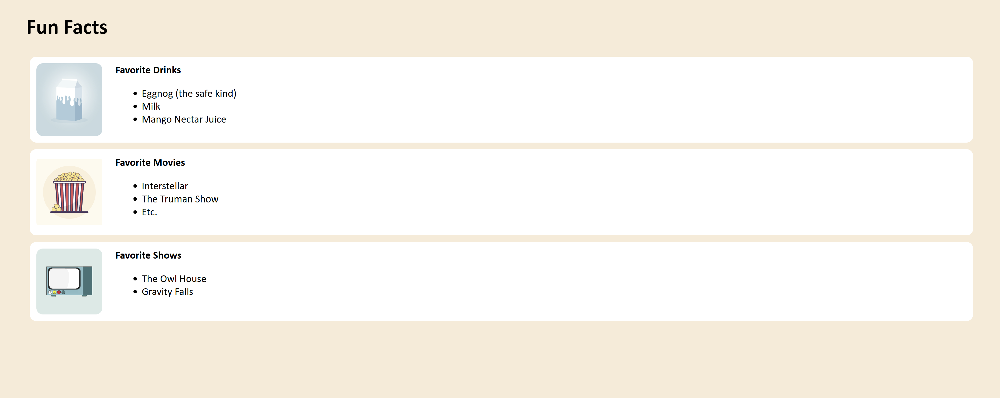
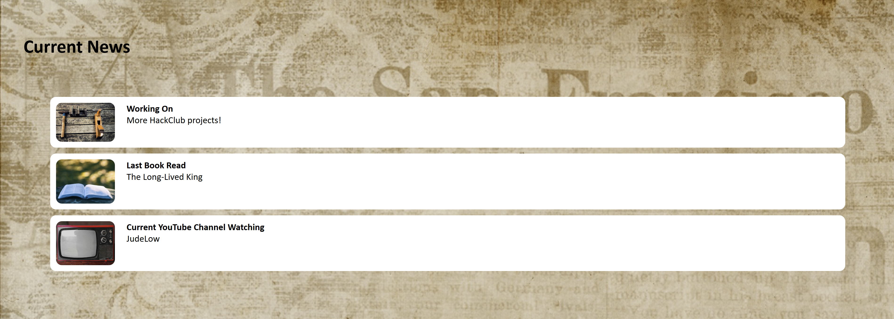
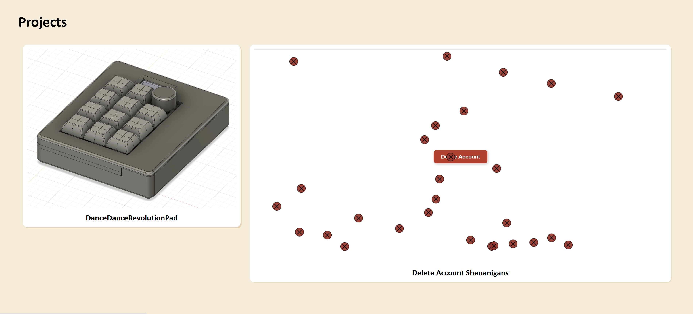
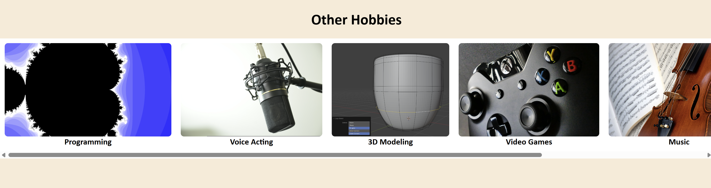

# Personal Website
A website showcasing my hobbies, interests, and projects.

Free free to look at some of my projects or hobbies that I have!

Try it here: https://evanthecat.github.io/Personal-Website/index.html

My website is split into a few sections:

## About Me
An introduction to who I am!

## Fun Facts
A section that lists some of my favorite things!

## Current News
Things that I'm currently working on.

## Projects
Projects that I've finished.

## Other Hobbies
Some info about my hobbies. Each icon represents a different hobby and redirects you to a different page!

## Resources Used
I used Pixabay for many of the stock images and used W3 Schools to learn more about various CSS features.